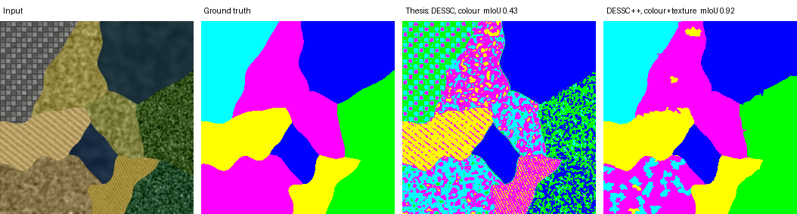

# Satellite Subspace Clustering




*Synthetic scene. Left to right: input, ground truth, the Master's thesis baseline (DESSC on colour features, pixel-wise), and DESSC++ with colour and texture features on superpixels.*

**Highlights**
- Python re-implementation of DESSC that matches the published Iris results to four decimals.
- Colour, texture (LBP, Gabor), superpixel and DINOv2 feature pipelines, evaluated with Hungarian matching and mean IoU.
- A diagnosis of why DESSC trailed k-means, and a one-line fix (k-means++ initialisation) that takes it from 0.79 to 0.93 mIoU on synthetic scenes.
- An honest benchmark on DeepGlobe with a majority-class baseline: DINOv2 features nearly double the gain over the baseline, while DESSC++ and k-means end up level.
- Gradio demo, 20 pytest tests, CI on every push.

Unsupervised land-cover segmentation of satellite images with **soft subspace clustering**. The core is a Python re-implementation of **DESSC** (Soft Subspace Clustering using a Differential Evolutionary algorithm), extended with modern features: colour spaces, texture, superpixels and self-supervised **DINOv2** embeddings.

**Research question:** soft subspace clustering was designed for high-dimensional data, yet it is usually applied to images with a handful of colour features. Does it beat k-means once pixels are described by hundreds of dimensions?

## What's inside

| Module | Content |
|---|---|
| `sscluster/dessc.py` | DESSC with a scikit-learn style API (`fit`, `predict`, `fit_predict`) |
| `sscluster/features.py` | Per-pixel features: thesis baseline, Lab, HSV, LBP texture, Gabor energy |
| `sscluster/superpixels.py` | SLIC superpixels: cluster regions instead of pixels |
| `sscluster/deep.py` | DINOv2 patch tokens → PCA → per-pixel feature map |
| `sscluster/segmentation.py` | Segmentation pipeline, DeepGlobe masks, Hungarian matching, mIoU |
| `benchmarks/` | Paper reproduction on UCI data, DeepGlobe benchmark, synthetic scenes, diagnosis of DESSC vs k-means |
| `app.py` | Gradio demo |
| `tests/` | 20 pytest tests |

## Quick start

```bash
pip install -r requirements.txt
python -m pytest -q
python benchmarks/uci_check.py
```

```python
from sscluster import DESSC
from sscluster.features import build_features
from sscluster.segmentation import segment

feats = build_features(img, ["lab", "lbp"])
labels = segment(img, DESSC(n_clusters=4), features=feats, superpixels=800)
```

### Demo

```bash
pip install gradio
python app.py
```

### DeepGlobe Land Cover (real images)

In most DeepGlobe tiles one class (usually agriculture) covers most of the image. With exactly one cluster per class, every method splits that dominant class by shade and misses the small ones, so Hungarian-matched mIoU collapses for all of them (about 0.16 on a first check). The evaluation therefore follows the usual over-clustering protocol for unsupervised segmentation: K = 8 clusters, each mapped to the majority ground-truth class among its pixels. The "unknown" class is ignored, as in the official DeepGlobe metric, and a **baseline** that labels the whole tile with its majority class shows what a method adds.

20 randomly sampled training tiles (`--shuffle`, seed 0), resized to 512 px, 800 superpixels, mean IoU:

| Features | Baseline | DESSC (paper) | DESSC++ | k-means |
|---|---|---|---|---|
| Thesis (colour, 5-D) | 0.268 | 0.343 | 0.341 | 0.356 |
| + Lab + LBP (21-D) | 0.268 | 0.360 | 0.369 | 0.374 |
| **DINOv2 ViT-S/14, PCA to 32-D** | 0.268 | **0.407** | **0.415** | **0.419** |

```bash
python benchmarks/deepglobe.py DATA --limit 20 --shuffle --features thesis --superpixels 800 --k 8
python benchmarks/deepglobe.py DATA --limit 20 --shuffle --features thesis,lab,lbp --superpixels 800 --k 8
python benchmarks/deepglobe.py DATA --limit 20 --shuffle --features dinov2 --superpixels 800 --k 8
```

**Findings**

1. **Features matter far more than the clustering algorithm.** The gain over the baseline roughly doubles from colour features (+0.08 mIoU) to DINOv2 (+0.15), and pixel accuracy reaches 0.90.
2. **On real images, DESSC does not beat k-means.** DESSC++ is within 0.005 mIoU of k-means for every feature set, each wins on a similar number of tiles, and k-means is about 9× faster. The clear advantage of DESSC++ on synthetic scenes did not carry over.
3. **A likely reason, and the next experiment.** The DINOv2 tokens are reduced with PCA, which decorrelates the dimensions and leaves little for per-cluster feature weighting to exploit. Clustering the full 384-D tokens is the real test of soft subspace clustering on deep features.
4. **Limits.** 20 tiles is a small sample: differences below about 0.01 mIoU should not be read as rankings. In 8 of the 20 tiles no method beats the baseline with hand-crafted features; small classes there are not separable by colour or texture.

## Design notes

- **Evaluation.** Cluster ids are arbitrary, so predictions are matched to ground-truth classes with the Hungarian algorithm before computing pixel accuracy and mean IoU.
- **Superpixels** remove salt-and-pepper noise and make DESSC about 5× faster. They also cap the reachable accuracy: no labelling can beat the majority class of each superpixel, so the number of superpixels matters.
- **Texture** separates regions that colour cannot: on a test scene with two regions of identical mean colour, LBP features reach mIoU > 0.9 where colour features fail.

## Environment

Results above were produced with Python 3.10–3.12, NumPy 2.x, scikit-learn 1.7–1.9 and scikit-image 0.25–0.26. The k-means++ seeding differs slightly across scikit-learn versions, so the third decimal of DESSC++ scores can move (e.g. 0.951 vs 0.952).

## License

MIT, see [LICENSE](LICENSE).

## Credits

- DESSC algorithm: Y. Li, Y. Lu, L. Jiao, *Soft subspace clustering using differential evolutionary algorithm*, IEEE CEC 2016.
- This project extends the Master's thesis *Regroupement dans les sous-espaces basé sur l'évolution différentielle pour la segmentation des images satellitaires* (Université Frères Mentouri Constantine 1, 2021) by Meroua Belhi and Djihane Maadoud, supervised by Dr. Amel Hebboul and Prof. Fella Hachouf. The original implementation was in MATLAB.
- DINOv2: M. Oquab et al., *DINOv2: Learning Robust Visual Features without Supervision*, 2023.
- Dataset: DeepGlobe Land Cover Classification Challenge (2018).
